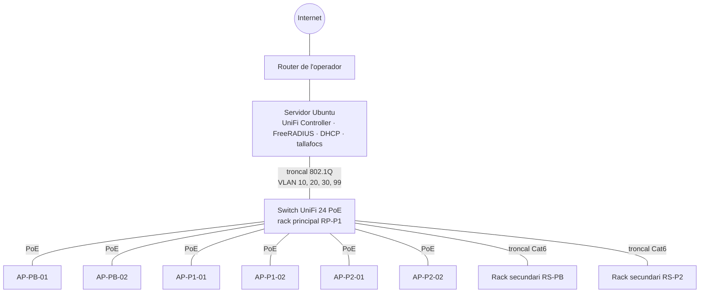

# Topologia de xarxa · WiFi SALUT

> **Issue:** #2 · Plànols de plantes i topologia de xarxa
> **Responsable:** AlumneB (tècnic/a d'instal·lació)

## 1. Plànols

| Planta | Plànol | Punts d'accés | Rack |
| --- | --- | --- | --- |
| Baixa | [planta-baixa.pdf](../planols/planta-baixa.pdf) | AP-PB-01 (passadís de recepció), AP-PB-02 (davant d'urgències i sala d'espera) | RS-PB · secundari 6U (magatzem) |
| Primera | [planta-primera.pdf](../planols/planta-primera.pdf) | AP-P1-01 (passadís de consultes), AP-P1-02 (davant d'infermeria) | **RP-P1 · principal 12U (sala tècnica)** |
| Segona | [planta-segona.pdf](../planols/planta-segona.pdf) | AP-P2-01 (passadís d'administració), AP-P2-02 (davant de la sala de reunions) | RS-P2 · secundari 6U (arxiu) |

### Criteris d'ubicació dels APs

- **2 APs per planta**, al sostre del passadís central, a 7,5 m dels extrems de l'edifici (30 m × 15 m). Cada AP cobreix un radi orientatiu de 8 m, de manera que les dues cel·les se solapen al centre de la planta i permeten la itinerància (*roaming*).
- Tots els APs estan a la **mateixa vertical** a les tres plantes. Així el cablejat puja pel patinet i recorre el mateix tram de fals sostre a cada planta.
- Els APs **no es munten dins de les consultes**: el passadís és una zona comuna i el manteniment no interromp l'atenció a pacients.

### Rutes de cablejat

1. Del rack principal (sala tècnica, planta primera) el cable entra al **patinet vertical**, que comunica les tres plantes.
2. A cada planta ix del patinet pel **fals sostre del passadís** i arriba fins a la vertical de cada AP.
3. Tots els enllaços dels APs van directes al patch panel del rack principal (enllaç permanent < 90 m).
4. Els racks secundaris queden connectats al principal amb dos cables troncals Cat6 i serveixen de punt de distribució per a les preses cablejades de cada planta.

## 2. Topologia lògica

Els sis APs emeten els tres SSIDs (**Admin**, **Salut** i **Convidats**). Cada SSID va etiquetat amb la seua VLAN fins al switch, i el servidor fa d'encaminador i tallafocs entre les VLANs. El disseny detallat de les VLANs i de l'adreçament és a la issue #4.

## 3. Resum d'equipament de la topologia

| Element | Quantitat | Ubicació |
| --- | --- | --- |
| Punt d'accés UniFi 6 Lite | 6 | 2 per planta, sostre del passadís |
| Switch UniFi 24 PoE | 1 | Rack principal (planta primera) |
| Servidor Ubuntu Server | 1 | Rack principal (planta primera) |
| Rack principal 12U | 1 | Sala tècnica (planta primera) |
| Rack secundari 6U | 2 | Planta baixa i planta segona |
